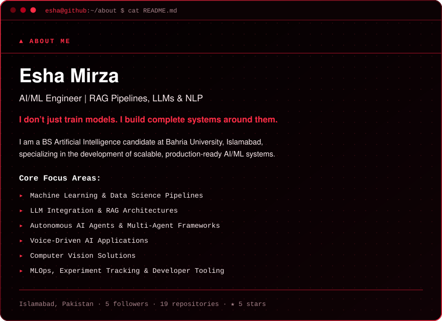
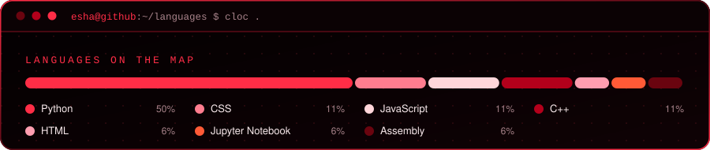

  

  

  

  

  <a href="https://github.com/Esha-Mirza/skitrack">skitrack</a> ·
  <a href="https://github.com/Esha-Mirza/Multimodal-RAG-Groq">Multimodal RAG</a> ·
  <a href="https://github.com/Esha-Mirza/voice-controlled-agent-ai">Voice Controlled Agent AI</a>

  

  

  

  

  
  
  
  

